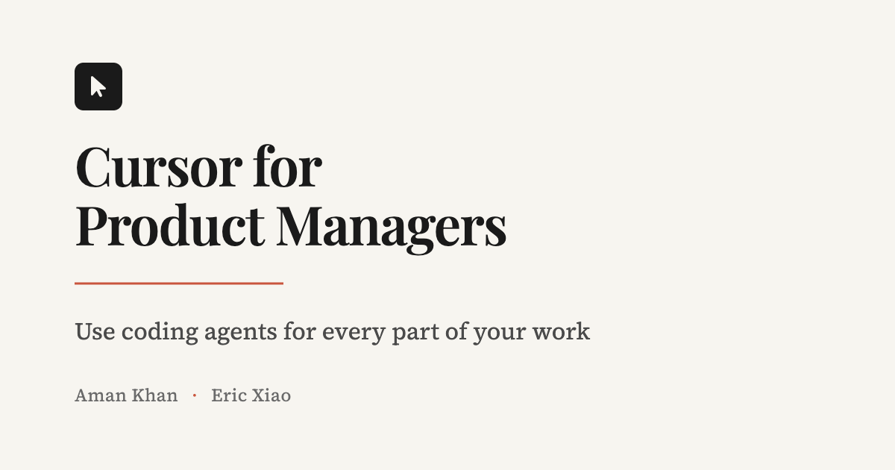
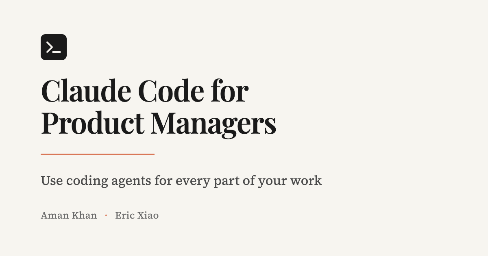

# Cursor for Product Managers — Homepage

> Landing page prototypes for the "Cursor for Product Managers" course by Aman Khan & Eric Xiao.

---

## What is this?

This project contains landing page design explorations for **Cursor for Product Managers**, a 2-week live cohort course hosted on Maven that teaches Product Managers how to build real products using AI coding tools like Cursor.

### Course Details
- **Price**: $1,950 USD
- **Format**: 2-week live cohort, 11 sessions
- **Instructors**: Aman Khan (Head of Product @ Arize AI) & Eric Xiao (Founder & AI PM)
- **Rating**: 5.0 on Maven
- **Target Audience**: Product Managers, UX Designers, Job Seekers

### Course Curriculum
1. **Brainstorm Features** — Setup coding agents on real codebases
2. **Build Prototypes** — Use agents as UX designers
3. **Master Cursor** — Agent memory, MCP connectors, dev tools
4. **AI Everywhere** — Analyze data, write docs, perform QA

---

## How it's built

### Tech Stack
- **HTML5** — Single-file pages
- **Tailwind CSS** — Via CDN (`https://cdn.tailwindcss.com`)
- **Font Awesome 6.5.1** — Icon library via CDN
- **Google Fonts** — Typography loaded per-design
- **Render.com** — Static site hosting with build script for env var injection

### Design Approach
Each design option is a complete, standalone HTML file that can be opened directly in a browser. No compilation, bundling, or server required.

### Key Patterns
- Responsive design using Tailwind breakpoints (`md:`, `lg:`)
- CSS custom properties for theme colors
- CSS animations for page load and hover effects
- Grayscale filter effect on company logos (color on hover)
- Typewriter animations for module demonstrations
- Favicon with cursor emoji (🖱️)

---

## Folder Structure

```
zurich-v1/
├── CLAUDE.md                 # This file - project documentation
├── README.md                 # Basic readme
├── styles.md                 # Active style guide (see below)
├── styles-zara.md            # Zara-inspired style guide
├── styles-notion.md          # Notion-inspired style guide
│
├── assets/                   # Images and logos
│   ├── aman.jpg             # Instructor photo - Aman Khan (primary)
│   ├── aman.webp            # Instructor photo - Aman Khan (legacy)
│   ├── eric.webp            # Instructor photo - Eric Xiao
│   ├── cursorforpms.webp    # Course logo
│   ├── ship10xfaster.webp   # Course preview image
│   ├── shipfinishedfeatures.webp  # Course preview image
│   ├── adobe.svg            # Company logo
│   ├── apple.svg            # Company logo
│   ├── arize.svg            # Company logo
│   ├── cruise.svg           # Company logo
│   ├── fountain.svg         # Company logo
│   ├── meta.svg             # Company logo
│   ├── spotify.webp         # Company logo
│   ├── UCB.svg              # Company logo (UC Berkeley)
│   ├── og-cursor.png        # OG image for Cursor (social sharing)
│   └── og-claude.png        # OG image for Claude Code (social sharing)
│
├── build.sh                  # Build script for Render (injects env vars)
├── og-image.html             # OG image template (Cursor)
├── og-image-claude.html      # OG image template (Claude Code)
├── index.html                # Design: Warm editorial "Studio" (cream/terracotta) - main entry point
├── neural.html               # Design: Dark tech brutalism (green/pink)
├── notion.html               # Design: Notion-inspired (black/white/blue)
├── zara.html                 # Design: Zara-inspired minimalist (black/white/red)
│
└── .context/                 # AI context files
    ├── notes.md
    ├── todos.md
    └── plans/
        └── homepage-design-plan-cursor-for-product-managers.md
```

---

## Current Design Options

All pages include a **floating style switcher** (bottom-right corner) that allows switching between themes.

### index.html — "Studio" (Warm Editorial)
- **Aesthetic**: Sophisticated editorial magazine feel
- **Background**: Cream (#f7f5f0)
- **Accents**: Terracotta (#c9553d), Sage (#4a6741)
- **Typography**: Playfair Display (serif) + Source Serif 4
- **Vibe**: Refined, warm, thoughtful
- **Note**: Primary entry point (renamed from default.html)

### neural.html — "Neural" (Dark Tech Brutalism)
- **Aesthetic**: Terminal-style, raw tech, unapologetic
- **Background**: Near-black (#0a0a0b)
- **Accents**: Electric green (#00ff88), Hot pink (#ff3366)
- **Typography**: Space Mono + IBM Plex Sans + Instrument Serif
- **Vibe**: Cutting-edge, developer-focused, bold

### notion.html — "Notion" (Clean & Functional)
- **Aesthetic**: Notion-inspired, clean, functional
- **Background**: Light gray (#f7f6f3)
- **Accents**: Blue (#2383e2), Black (#37352f)
- **Typography**: Inter
- **Vibe**: Professional, organized, familiar

### zara.html — "Zara" (Minimalist Luxury)
- **Aesthetic**: High-fashion minimalism
- **Background**: Pure white (#ffffff)
- **Accents**: Red (#EB4C4C), Black (#000000)
- **Typography**: Helvetica Now Text (system sans-serif)
- **Vibe**: Sleek, confident, editorial

---

## Content Sources

Homepage content was gathered from:
1. **learn.cursorpm.com** — Course curriculum and lesson structure
2. **maven.com/aman-khan/coding-agents-for-product-managers** — Pricing, testimonials, instructor bios

### Testimonials (Real)
- **Blake** — Product Lead @ AllTrails
- **Jerry** — UX Lead @ Gartner
- **Mel** — CX Lead @ Dragonfly

---

## Development Notes

### To Preview
Simply open any `.html` file in a browser. No server needed.

### To Edit Styles
Each HTML file contains its own `<style>` block and Tailwind config. Edit inline.

### Adding New Designs
1. Copy an existing option file
2. Modify the color palette in `tailwind.config`
3. Update the `<style>` block with new CSS
4. Swap out Google Fonts links as needed

---

## Deployment (Render.com)

The site is deployed as a static site on Render.com with environment variable injection.

### Build Configuration
- **Build Command:** `./build.sh`
- **Publish Directory:** `.`

### Environment Variables

| Variable | Description | Example |
|----------|-------------|---------|
| `SITE_URL` | Full URL of the deployed site | `https://cursorforpms.com` |
| `OG_IMAGE` | OG image filename to use | `og-cursor.png` or `og-claude.png` |

### How It Works
1. `build.sh` runs at deploy time
2. Replaces `__SITE_URL__` and `__OG_IMAGE__` placeholders in `index.html`
3. Social crawlers see the correct absolute URLs for OG images

### Testing Locally
```bash
SITE_URL=https://cursorforpms.com OG_IMAGE=og-cursor.png ./build.sh
```

---

## Social Sharing (OG Images)

### Available OG Images
| Image | File | Use For |
|-------|------|---------|
|  | `og-cursor.png` | Cursor for Product Managers |
|  | `og-claude.png` | Claude Code for Product Managers |

### OG Image Specs
- **Dimensions:** 1200×630px (recommended for iMessage, Twitter, LinkedIn)
- **Format:** PNG
- **Style:** Matches the "Studio" theme (cream background, Playfair Display font)

### Regenerating OG Images
1. Edit `og-image.html` or `og-image-claude.html`
2. Open in browser at 1200×630 viewport
3. Take screenshot and save to `assets/`

### Testing OG Tags
After deploying, test at:
- https://www.opengraph.xyz/
- https://cards-dev.twitter.com/validator
